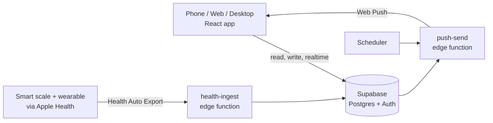

<div align="center">

# Arete

**A private, all-in-one app for training, nutrition and self-improvement.**
Log workouts and meals fast, see your progress clearly, and let a transparent rules-based coach keep your plan in step with your data.


</div>

---

## Why Arete

- **One codebase, every screen.** The same React app ships as an installable phone app (PWA), a website and a Windows desktop app.
- **Fast logging.** Search a bundled database of about 19,000 foods, scan barcodes, reuse favourites and remembered portions, or log a set with one tap.
- **A coach that shows its working.** No black box and no AI subscription: fixed, tested rules adjust targets from your logs, explain why, and always offer Undo.
- **Your data stays yours.** It lives in your own Supabase project. Nothing is sent to a third-party analytics or advertising service.
- **Works offline.** Writes are queued on the device and sync when you reconnect.

---

## Features

| Area | What you get |
|---|---|
| **Train** | Session logger with progressive overload, rest timer, personal bests and readiness-aware weights. A split planner with 16 templates, a 120+ exercise library with demos and form notes, muscle ranking and full history |
| **Fuel** | Food logger with barcode scanning and photos, recipe builder, custom foods, meal plans with a shopping list, a water coach and a micronutrient coach |
| **Progress** | Weight trend and pace, body measurements, progress photos, weekly check-ins, goal projections, sleep, habits and insights |
| **Look** | Skincare routines with ingredient-conflict warnings, plus hair, grooming and style tracking |
| **Home** | A customisable dashboard: calories left, weight, streak, water, sleep and readiness, and health metrics |
| **Coach** | A rules engine that adapts calories, macros, water and training split to your real data, and reads wearable signals such as resting heart rate, HRV, sleep and activity |
| **Plan import** | Paste a meal or training plan from any source (an AI assistant, a coach, your notes). Fixed rules read it, you review it, then it is saved. Longer coaching documents can be kept alongside your real plan as options |
| **Health sync** | Smart scales and wearables flow through Apple Health into your database, then into Home, Progress and the coach |
| **Reminders** | Free scheduled push notifications at times you choose, with no SMS service or phone number needed |

---

## Quick start

Requires Node 20 or later.

```bash
npm install
cp .env.example .env      # add your Supabase project details
npm run dev               # http://localhost:1420
```

On the dev server only, the lock screen and sign-in are skipped so you can explore screens. Add `?login=1` to see the real gates, or `?demo=1` for sample health data. Nothing syncs in that mode, and these shortcuts are stripped from production builds.

### Configuration

| Variable | Purpose |
|---|---|
| `VITE_SUPABASE_URL`, `VITE_SUPABASE_ANON_KEY` | Your Supabase project (the anon key is public by design) |
| `VITE_VAPID_PUBLIC_KEY` | Public key for push reminders (optional) |
| `VITE_SENTRY_DSN` | Error reporting (optional) |

Anything prefixed `VITE_` is embedded in the shipped app, so never put a secret in one. Server secrets belong in Supabase (Edge Functions > Secrets).

### Scripts

| Command | What it does |
|---|---|
| `npm run dev` | Start the dev server |
| `npm test` | Run the test suite |
| `npm run build:pwa` | Build the PWA into `dist/` |
| `npm run build` | Build the desktop web bundle |
| `npm run tauri dev` | Run the desktop app (needs the Rust toolchain) |
| `npm run release` | Build the Windows installer |

---

## Architecture



- **Frontend:** React 19 with Vite, Tailwind and a small CSS motion system. Screens are lazy-loaded chunks.
- **Backend:** Supabase for storage, auth and realtime. Edge functions handle health ingestion and push reminders.
- **Desktop:** a thin Tauri shell around the same web bundle.
- **Logic:** all rules (coach, goals, splits, recovery, food search, plan importers) are pure functions in `src/domain`, each with tests.

### Project layout

```
src/
  tabs/         Full screens
  components/   Reusable UI
  mobile/       Phone-specific screens and sheets
  domain/       Pure, tested logic
  hooks/        Data and state hooks
  supabase/     Client, offline queue, realtime sync
  utils/        Helpers
  nav/          Navigation groups
  data/         Bundled food and exercise data (lazy-loaded)
  styles/       Design tokens and motion
supabase/       SQL schemas and edge functions
src-tauri/      Desktop shell (Rust)
scripts/        Setup and data-building scripts
docs/           Runbooks, specs and reference notes
```

---

## Deploying

**Web / PWA.** Run `npm run build:pwa`, then deploy the `dist` folder to any static host. `netlify.toml` is included for Netlify. Preview the production bundle first with `npx vite preview --outDir dist`.

**Desktop.** `npm run release` builds a Windows installer.

**Backend.** Run the SQL files in `supabase/` (they are idempotent) in the Supabase SQL Editor, then deploy the functions in `supabase/functions/`. Lock the project to your own account by turning off public sign-ups and setting the `OWNER_USER_ID` secret.

| Guide | Covers |
|---|---|
| [`docs/deploy-runbook.md`](docs/deploy-runbook.md) | Going live with your own accounts |
| [`docs/health-ingest-checklist.md`](docs/health-ingest-checklist.md) | Connecting a smart scale and wearable |
| [`docs/push-setup.md`](docs/push-setup.md) | Scheduled push reminders |
| [`docs/services-and-costs.md`](docs/services-and-costs.md) | Every service and what it costs |

---

## Engineering principles

- **Pure logic, thin UI.** Rules live in `src/domain` with a test beside them.
- **Safe by default.** No secrets in the client, owner-only database policies, and no destructive migrations.
- **Honest data.** A missing reading is treated as unknown, never as zero, and estimates are labelled as estimates.
- **Every platform counts.** A change that works in the browser but breaks the desktop build is not finished.
- **Accessible and fast.** Large touch targets, reduced-motion support, and lazy-loaded screens.

## Documentation

See [`docs/README.md`](docs/README.md) for the full index, and [`HANDOVER-CODEX.md`](HANDOVER-CODEX.md) for project status and engineering notes.

## Data sources

Food data comes from USDA FoodData Central (public domain) and Open Food Facts (ODbL, credited in the app). Exercise demonstrations use the free-exercise-db dataset (public domain).

## Privacy

Arete is built for a single owner and holds sensitive personal data. Run it against your own Supabase project, keep the repository private if it contains your history, and never commit your `.env` file.
